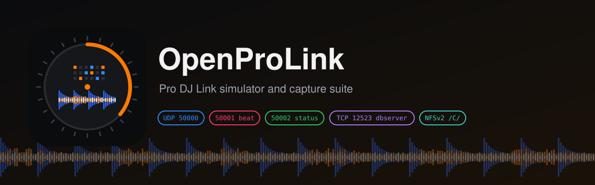

<p align="center"></p>

<p align="center"><b>English</b> · <a href="./README.zh-CN.md">简体中文</a> · <a href="./README.zh-TW.md">繁體中文</a></p>

**OpenCDJ-3000** is a software player for Pro DJ Link test benches. It joins the link as a virtual CDJ-3000 and serves a rekordbox USB stick to the device under test. You watch and control it from a web page: what the deck sends, what the other side understands, and every packet in between. No real player has to be on the bench.

> **Status: early.** Packet layouts follow Deep Symmetry's protocol analysis (`dysentery`, `beat-link`, `crate-digger`), not captures from our own hardware. A passing run proves that the device under test and this simulator agree. Only a real player proves compatibility.

## What it does

| Panel | What you get |
| --- | --- |
| **Virtual CDJ-3000** | Player number 1–4, Play / Pause / Cue, tempo ±6 / ±10 / ±16 % / WIDE, beat counter, scrolling 3-band waveform and overview, USB track list, audio in the browser |
| **Device under test** | The [EngineX OS](https://github.com/Cd1s/EngineX-OS) Pro DJ Link receiver running in-process: the players, BPM, pitch, beat and play state it decodes, and the waveform it fetched over NFS |
| **CDJ → Denon import** | Copies the virtual USB over NFSv2 and runs EngineX's rb-bridge, then lists the Engine playlists it built |
| **[LINK] Denon → CDJ** | Browses the EngineX export with a dbserver client (TCP 12523), loads a track over NFSv2, shows its waveform and plays it; shows the export yielding its player number on a collision |
| **Wire inspector** | UDP 50000 keepalive, 50001 beat + 30 ms `0x0b` playhead, 50002 status + `0x05/0x06` media query, dbserver requests and NFS reads, with the first bytes of each in hex |

The default USB stick is generated: 32 bars of 120 BPM drums with a matching beatgrid, PWV5 colour and PWV7 3-band waveforms. Pass `-usb` to use a real rekordbox export.

## Quick start

Build and run on a Linux host (it uses the loopback addresses 127.0.0.1 and 127.0.0.2, and UDP ports 50000–50002):

```sh
go build -trimpath -o bin/cdj3000-sim ./cmd/cdj3000-sim
./bin/cdj3000-sim -http 127.0.0.1:18300                # generated USB stick
./bin/cdj3000-sim -usb /path/to/USB -http 127.0.0.1:18300
```

The web page listens on loopback only. From your laptop:

```sh
ssh -L 18300:127.0.0.1:18300 <build host>
open http://127.0.0.1:18300
```

| Flag | Default | Meaning |
| --- | --- | --- |
| `-http` | `127.0.0.1:18300` | Web UI address. Keep it on loopback |
| `-usb` | generated | rekordbox USB root with `PIONEER/rekordbox/export.pdb` |
| `-sim-ip` | `127.0.0.2` | Address the virtual CDJ sends from and serves NFS on |
| `-denon-ip` | `127.0.0.1` | Address the device-under-test receiver listens on |
| `-denon-empty` | off | The Denon drive holds no rekordbox export of its own |

## Repository layout

| Path | Contents |
| --- | --- |
| `cmd/cdj3000-sim/` | The simulator: playhead clock, generated USB stick, reverse link and web UI |
| `pkg/cdj/` | Independent CDJ-side packet builders/parsers (`0x06`, `0x0a`, `0x28`, `0x0b`, `0x05/0x06`), dbserver client, ANLZ parser and captured-wire tests |
| `third_party/enginex/` | Read-only copy of the EngineX OS packages under test. Refresh with `scripts/sync-enginex.sh`, never edit |
| `docs/ARCHITECTURE.md` | Components, data flow, test strategy and roadmap |
| `docs/PROLINK-WIRE-SPEC.md` | Every packet the simulator sends or parses, byte by byte |

## Trademarks

Pioneer DJ, CDJ, rekordbox and Pro DJ Link are trademarks of AlphaTheta Corporation. Denon DJ and Engine DJ are trademarks of inMusic Brands. This project is not affiliated with or endorsed by either company. Model names describe the hardware it emulates.

## License

MIT. `third_party/enginex` is EngineX OS code under its own MIT license.
