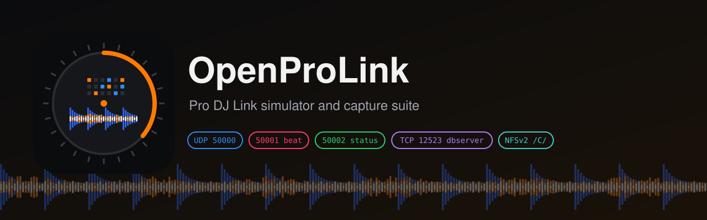

<p align="center"></p>

<p align="center"><a href="./README.md">English</a> · <b>简体中文</b> · <a href="./README.zh-TW.md">繁體中文</a></p>

# OpenProLink

**开源的先锋 Pioneer DJ / AlphaTheta Pro DJ Link 硬件模拟器（CDJ-3000 / XDJ）与全协议采集套件（CDJ / XDJ / DJM 混音台）。**

OpenProLink 有两个工具：

- **`prolink-probe`** 采集先锋真机碟机和混音台发出的全部数据：每种包的发包频率、原始十六进制样本、解析结果，以及你操作设备时哪些字节变了。你在自己的设备上跑一次，开发者就拿到了平时要把真机摆在桌上才有的数据。
- **`cdj3000-sim`** 是给 Pro DJ Link 测试台用的软件碟机：它以虚拟 CDJ-3000 的身份加入网络，把一个 rekordbox U 盘提供给被测设备；你在网页上看它、控制它：碟机发了什么、对方解析出了什么、中间每一个包。

它是为 [EngineX OS](https://github.com/Cd1s/EngineX-OS) 做的。EngineX OS 是 Denon DJ / Numark / Rane 一体机的定制系统，通过 Pro DJ Link 与先锋碟机联机。

> **状态：早期。** 模拟器的包格式依据 Deep Symmetry 的协议分析（`dysentery`、`beat-link`、`crate-digger`）。测试通过只说明被测设备和本模拟器彼此一致，兼容性要以真机为准。所以真机碟机和混音台的采集数据很重要，欢迎提交。

## 用 prolink-probe 采集你的设备

征集：**CDJ-3000、CDJ-2000NXS2、XDJ-AZ、XDJ-XZ、DJM-A9、DJM-V10、DJM-900NXS2**，以及其他任何 Pro DJ Link 碟机和混音台。

1. 电脑和设备接到同一台交换机或路由器上（XDJ-XZ / XDJ-AZ 也可以直接接机身的 LAN 口）。先退出 rekordbox 等 Pro DJ Link 软件，它们会占用同样的端口。
2. 安装 [Go](https://go.dev/dl/) 1.26 或更新版本，在本仓库目录运行：

   ```sh
   go run ./cmd/prolink-probe -duration 60s -out capture.json
   ```

   macOS 或 Windows 询问是否允许传入连接时选允许。按 Ctrl-C 可以提前结束，报告照样会写出。
3. 在这 60 秒里**一次只做一个操作，每个操作间隔约 3 秒**，并大致记下每个操作是第几秒做的（做什么见下表）。
4. 检查 `capture.json`，然后附到[真机采集 Issue](https://github.com/Cd1s/OpenProLink/issues/new?template=device-capture.md) 里，写上型号、固件版本、连接方式和你的操作清单。

| 设备 | 最能暴露字段的操作 |
| --- | --- |
| **CDJ-3000 / CDJ-2000NXS2** | 从 U 盘加载曲目、播放 / 暂停、推 Pitch 推子、切换调速范围、Master Tempo 开关、**Quantize 开关**、本机按 **MASTER** 再到另一台按、**SYNC** 开关、打一个 Loop、Hot Cue、弹出 U 盘 |
| **XDJ-AZ / XDJ-XZ** | 每个 deck 做上面的碟机操作，再加混音区：逐个推拉通道推子、Crossfader、**Beat FX** 开关、换效果、拧节拍 / **TIME** 旋钮和 Level/Depth 旋钮、Quantize |
| **DJM-A9 / DJM-V10 / DJM-900NXS2** | **通道推子**一次推拉一个（碟机的 On-Air 红圈灯会跟着变）、Crossfader、**Beat FX** 开关、换效果和作用通道、节拍键（1/2、1、2 …）、**TIME** 旋钮、Level/Depth、混音台的 **Quantize**、Tap 或自动 BPM |

### 工具做了什么

默认先**监听 1.5 秒**，然后用 **7 到 15 中第一个空闲的机号**以虚拟碟机身份加入网络（1–6 留给碟机，rekordbox 用 0x11 起，混音台用 0x21 起），每秒广播一次 keepalive。碟机和混音台的大部分数据只单播给已经在网上注册过的设备，不做这一步，电脑基本只能收到 keepalive 和节拍包。然后它会：

- 给每台碟机的 USB 和 SD 各发一次**媒体查询（`0x05`）**，记录**媒体应答（`0x06`）**；
- 连接每台碟机的 **dbserver**（TCP 12523 查端口、greeting、setup、根菜单和 render），每条消息都保存原始十六进制和解析后的参数。碟机拒绝机号大于 4 的 dbserver 客户端，所以和 beat-link 一样借用被查询碟机自己的机号；
- 记录 **UDP 50000、50001、50002 上收到的所有包**：keepalive、CDJ 状态 `0x0a`、混音台状态 `0x29`、节拍 `0x28`、CDJ-3000 每 30 ms 一个的精确位置 `0x0b`、通道 On-Air `0x03`、Master 交接 `0x26`/`0x27`、Sync 控制 `0x2a`，以及还没人记录过的包。

它从不发送状态、节拍、Master、Sync、推子或加载命令。有设备占用了它的机号时，它会换一个。`-passive` 只监听，不发任何包。

| 参数 | 默认值 | 含义 |
| --- | --- | --- |
| `-duration` | `15s` | 采集时长；边操作边采集时用 60 秒以上 |
| `-out` | `capture.json` | 报告文件 |
| `-passive` | 关 | 只监听：不注册、不查询（碟机发来的数据会少很多） |
| `-number` | 7–15 中第一个空闲的 | 注册用的虚拟机号 |
| `-iface` | 与设备同网段的网卡 | 注册用的网卡 |
| `-samples` | `16` | 每种包保留的原始十六进制样本数，每秒最多一个 |

### 报告里有什么

| 键 | 内容 |
| --- | --- |
| `devices` | 听到的每台设备：名称、机号、设备类别、固件（取自它的状态包）、首次出现时间 |
| `streams` | 每个（设备、端口、类型、子类型、长度）一条：包数、间隔毫秒（平均/最小/最大）、最后一个包的解析结果、原始十六进制样本 |
| `streams[].changed_bytes` | 采集期间变化过的每个偏移：已知含义（空白表示还没人记录过的字段）、首个/末个/最小/最大值、变化次数、出现过的值，以及第一次和最后一次变化的时间。把时间和你的操作清单对上，就能找到旋钮对应的字节 |
| `media_queries` | 发出的每个 `0x05`，以及碟机是否应答 |
| `dbserver` | 每台碟机、每个卡槽：dbserver 端口、根菜单条目和完整的消息记录 |
| `notes` | 使用的机号、换机号记录、没收到数据之类的问题 |

**隐私。** 包里的 IP 和 MAC 地址会换成替代值（`10.0.0.x`、`02:00:00:00:00:xx`），其余每个字节都原样保留，包括 U 盘名称和曲目 ID。如果在协议存放地址以外的位置出现和真实 IP 相同的 4 个字节，工具不会改动它，只在 `unredacted_ip_like` 里列出偏移；提交前请检查。

## 模拟器

| 面板 | 内容 |
| --- | --- |
| **虚拟 CDJ-3000** | 机号 1–4、播放 / 暂停 / CUE、调速 ±6 / ±10 / ±16 % / WIDE、拍号计数、滚动三段波形与总览、U 盘曲目表、浏览器内播放 |
| **被测设备** | 进程内运行 [EngineX OS](https://github.com/Cd1s/EngineX-OS) 的 Pro DJ Link 接收端：它识别出的碟机、BPM、pitch、拍号、播放状态，以及它经 NFS 取到的波形 |
| **CDJ → Denon 导入** | 经 NFSv2 拷贝虚拟 U 盘并运行 EngineX 的 rb-bridge，列出生成的 Engine 歌单 |
| **[LINK] Denon → CDJ** | 用 dbserver 客户端（TCP 12523）浏览 EngineX 导出、经 NFSv2 加载曲目、显示波形并播放；演示机号冲突时导出端自动让位 |
| **抓包面板** | UDP 50000 keepalive、50001 beat 与 30 ms `0x0b` 精确播放头、50002 status 与 `0x05/0x06` 媒介查询、dbserver 请求与 NFS 读取，附每个包开头的十六进制 |

默认 U 盘是生成的：32 小节 120 BPM 鼓组，带对应的 beatgrid、PWV5 彩色波形和 PWV7 三段波形。用 `-usb` 指定真实的 rekordbox 导出。

### 快速开始

在 Linux 主机上编译运行（使用回环地址 127.0.0.1、127.0.0.2 和 UDP 50000–50002）：

```sh
go build -trimpath -o bin/cdj3000-sim ./cmd/cdj3000-sim
./bin/cdj3000-sim -http 127.0.0.1:18300                # 生成的 U 盘
./bin/cdj3000-sim -usb /path/to/USB -http 127.0.0.1:18300
```

网页只监听回环地址。在你的电脑上：

```sh
ssh -L 18300:127.0.0.1:18300 <编译机>
open http://127.0.0.1:18300
```

| 参数 | 默认值 | 含义 |
| --- | --- | --- |
| `-http` | `127.0.0.1:18300` | 网页地址，保持在回环 |
| `-usb` | 生成 | 含 `PIONEER/rekordbox/export.pdb` 的 rekordbox U 盘根目录 |
| `-sim-ip` | `127.0.0.2` | 虚拟 CDJ 的发包地址和 NFS 地址 |
| `-denon-ip` | `127.0.0.1` | 被测接收端的监听地址 |
| `-denon-empty` | 关 | Denon 盘上没有自己的 rekordbox 导出 |
| `-deck` | 无 | 局域网里要联机的 EngineX 真机 IPv4，多台用逗号分隔（`-sim-ip` 设成本机的局域网地址） |
| `-ableton-link` | 关 | 把速度和小节相位发布为 Ableton Link 会话 |

## 仓库结构

| 路径 | 内容 |
| --- | --- |
| `cmd/prolink-probe/` | 采集工具，以及用模拟 CDJ-3000 和 DJM-V10 做的测试 |
| `cmd/cdj3000-sim/` | 模拟器：播放时钟、生成的 U 盘、反向 Link 与网页 |
| `pkg/cdj/` | 独立的 CDJ 侧报文构造/解析（`0x06`、`0x0a`、`0x28`、`0x0b`、`0x05/0x06`）、dbserver 客户端、ANLZ 解析与实机抓包对表测试 |
| `third_party/enginex/` | 被测的 EngineX OS 代码只读副本，用 `scripts/sync-enginex.sh` 更新，不要直接改 |
| `docs/ARCHITECTURE.md` | 组件、数据流、测试策略与路线图 |
| `docs/PROLINK-WIRE-SPEC.md` | 模拟器收发的每个包，逐字节说明 |

## 商标

Pioneer DJ、CDJ、XDJ、DJM、rekordbox、Pro DJ Link 是 AlphaTheta Corporation 的商标；Denon DJ、Engine DJ 是 inMusic Brands 的商标。本项目与上述公司无关，也未获其认可。型号名称仅用于说明所模拟或采集的硬件。

## 许可证

MIT。`third_party/enginex` 是 EngineX OS 的代码，沿用其 MIT 许可证。
