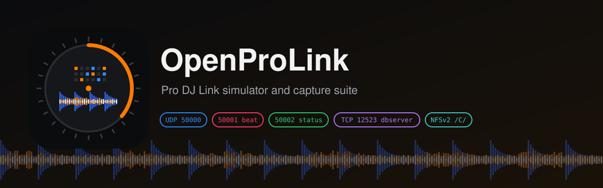

<p align="center"></p>

<p align="center"><a href="./README.md">English</a> · <a href="./README.zh-CN.md">简体中文</a> · <b>繁體中文</b></p>

# OpenProLink

**開源的先鋒 Pioneer DJ / AlphaTheta Pro DJ Link 硬體模擬器（CDJ-3000 / XDJ）與全協定擷取套件（CDJ / XDJ / DJM 混音台）。**

OpenProLink 有兩個工具：

- **`prolink-probe`** 擷取先鋒實機播放機和混音台送出的全部資料：每種封包的送包頻率、原始十六進位樣本、解析結果，以及你操作設備時哪些位元組變了。你在自己的設備上跑一次，開發者就拿到了平常要把實機擺在桌上才有的資料。
- **`cdj3000-sim`** 是給 Pro DJ Link 測試台用的軟體播放機：它以虛擬 CDJ-3000 的身分加入網路，把一個 rekordbox 隨身碟提供給受測裝置；你在網頁上看它、控制它：播放機送了什麼、對方解析出了什麼、中間每一個封包。

它是為 [EngineX OS](https://github.com/Cd1s/EngineX-OS) 做的。EngineX OS 是 Denon DJ / Numark / Rane 一體機的客製系統，透過 Pro DJ Link 與先鋒播放機連線。

> **狀態：早期。** 模擬器的封包格式依據 Deep Symmetry 的協定分析（`dysentery`、`beat-link`、`crate-digger`）。測試通過只說明受測裝置與本模擬器彼此一致，相容性要以實機為準。所以實機播放機和混音台的擷取資料很重要，歡迎提交。

## 用 prolink-probe 擷取你的設備

徵集：**CDJ-3000、CDJ-2000NXS2、XDJ-AZ、XDJ-XZ、DJM-A9、DJM-V10、DJM-900NXS2**，以及其他任何 Pro DJ Link 播放機和混音台。

1. 電腦和設備接到同一台交換器或路由器上（XDJ-XZ / XDJ-AZ 也可以直接接機身的 LAN 埠）。先關閉 rekordbox 等 Pro DJ Link 軟體，它們會佔用同樣的連接埠。
2. 安裝 [Go](https://go.dev/dl/) 1.26 或更新版本，在本儲存庫目錄執行：

   ```sh
   go run ./cmd/prolink-probe -duration 60s -out capture.json
   ```

   macOS 或 Windows 詢問是否允許傳入連線時選允許。按 Ctrl-C 可以提前結束，報告照樣會寫出。
3. 在這 60 秒裡**一次只做一個操作，每個操作間隔約 3 秒**，並大致記下每個操作是第幾秒做的（做什麼見下表）。
4. 檢查 `capture.json`，然後附到[實機擷取 Issue](https://github.com/Cd1s/OpenProLink/issues/new?template=device-capture.md) 裡，寫上型號、韌體版本、連接方式和你的操作清單。

| 設備 | 最能暴露欄位的操作 |
| --- | --- |
| **CDJ-3000 / CDJ-2000NXS2** | 從隨身碟載入曲目、播放 / 暫停、推 Pitch 推桿、切換調速範圍、Master Tempo 開關、**Quantize 開關**、本機按 **MASTER** 再到另一台按、**SYNC** 開關、打一個 Loop、Hot Cue、退出隨身碟 |
| **XDJ-AZ / XDJ-XZ** | 每個 deck 做上面的播放機操作，再加混音區：逐一推拉通道推桿、Crossfader、**Beat FX** 開關、換效果、轉節拍 / **TIME** 旋鈕和 Level/Depth 旋鈕、Quantize |
| **DJM-A9 / DJM-V10 / DJM-900NXS2** | **通道推桿**一次推拉一個（播放機的 On-Air 紅圈燈會跟著變）、Crossfader、**Beat FX** 開關、換效果和作用通道、節拍鍵（1/2、1、2 …）、**TIME** 旋鈕、Level/Depth、混音台的 **Quantize**、Tap 或自動 BPM |

### 工具做了什麼

預設先**監聽 1.5 秒**，然後用 **7 到 15 中第一個空閒的機號**以虛擬播放機身分加入網路（1–6 留給播放機，rekordbox 用 0x11 起，混音台用 0x21 起），每秒廣播一次 keepalive。播放機和混音台的大部分資料只單播給已經在網路上註冊過的設備，不做這一步，電腦基本上只收得到 keepalive 和節拍封包。接著它會：

- 對每台播放機的 USB 和 SD 各送一次**媒體查詢（`0x05`）**，記錄**媒體回應（`0x06`）**；
- 連接每台播放機的 **dbserver**（TCP 12523 查連接埠、greeting、setup、根選單和 render），每則訊息都保存原始十六進位和解析後的參數。播放機拒絕機號大於 4 的 dbserver 用戶端，所以和 beat-link 一樣借用被查詢播放機自己的機號；
- 記錄 **UDP 50000、50001、50002 上收到的所有封包**：keepalive、CDJ 狀態 `0x0a`、混音台狀態 `0x29`、節拍 `0x28`、CDJ-3000 每 30 ms 一個的精確位置 `0x0b`、通道 On-Air `0x03`、Master 交接 `0x26`/`0x27`、Sync 控制 `0x2a`，以及還沒人記錄過的封包。

它從不送出狀態、節拍、Master、Sync、推桿或載入命令。有設備佔用了它的機號時，它會換一個。`-passive` 只監聽，不送任何封包。

| 參數 | 預設值 | 含義 |
| --- | --- | --- |
| `-duration` | `15s` | 擷取時長；邊操作邊擷取時用 60 秒以上 |
| `-out` | `capture.json` | 報告檔 |
| `-passive` | 關 | 只監聽：不註冊、不查詢（播放機送來的資料會少很多） |
| `-number` | 7–15 中第一個空閒的 | 註冊用的虛擬機號 |
| `-iface` | 與設備同網段的網卡 | 註冊用的網卡 |
| `-samples` | `16` | 每種封包保留的原始十六進位樣本數，每秒最多一個 |

### 報告裡有什麼

| 鍵 | 內容 |
| --- | --- |
| `devices` | 聽到的每台設備：名稱、機號、設備類別、韌體（取自它的狀態封包）、首次出現時間 |
| `streams` | 每個（設備、連接埠、類型、子類型、長度）一筆：封包數、間隔毫秒（平均/最小/最大）、最後一個封包的解析結果、原始十六進位樣本 |
| `streams[].changed_bytes` | 擷取期間變化過的每個偏移：已知含義（空白表示還沒人記錄過的欄位）、首個/末個/最小/最大值、變化次數、出現過的值，以及第一次和最後一次變化的時間。把時間和你的操作清單對上，就能找到旋鈕對應的位元組 |
| `media_queries` | 送出的每個 `0x05`，以及播放機是否回應 |
| `dbserver` | 每台播放機、每個卡槽：dbserver 連接埠、根選單項目和完整的訊息記錄 |
| `notes` | 使用的機號、換機號記錄、沒收到資料之類的問題 |

**隱私。** 封包裡的 IP 和 MAC 位址會換成替代值（`10.0.0.x`、`02:00:00:00:00:xx`），其餘每個位元組都原樣保留，包括隨身碟名稱和曲目 ID。如果在協定存放位址以外的位置出現和真實 IP 相同的 4 個位元組，工具不會改動它，只在 `unredacted_ip_like` 裡列出偏移；提交前請檢查。

## 模擬器

| 面板 | 內容 |
| --- | --- |
| **虛擬 CDJ-3000** | 機號 1–4、播放 / 暫停 / CUE、調速 ±6 / ±10 / ±16 % / WIDE、拍號計數、捲動三段波形與總覽、隨身碟曲目表、瀏覽器內播放 |
| **受測裝置** | 程序內執行 [EngineX OS](https://github.com/Cd1s/EngineX-OS) 的 Pro DJ Link 接收端：它辨識出的播放機、BPM、pitch、拍號、播放狀態，以及它經 NFS 取得的波形 |
| **CDJ → Denon 匯入** | 經 NFSv2 複製虛擬隨身碟並執行 EngineX 的 rb-bridge，列出產生的 Engine 歌單 |
| **[LINK] Denon → CDJ** | 用 dbserver 用戶端（TCP 12523）瀏覽 EngineX 匯出、經 NFSv2 載入曲目、顯示波形並播放；示範機號衝突時匯出端自動讓位 |
| **封包面板** | UDP 50000 keepalive、50001 beat 與 30 ms `0x0b` 精確播放頭、50002 status 與 `0x05/0x06` 媒體查詢、dbserver 請求與 NFS 讀取，附每個封包開頭的十六進位 |

預設隨身碟是產生的：32 小節 120 BPM 鼓組，附對應的 beatgrid、PWV5 彩色波形與 PWV7 三段波形。用 `-usb` 指定真實的 rekordbox 匯出。

### 快速開始

在 Linux 主機上編譯執行（使用迴路位址 127.0.0.1、127.0.0.2 與 UDP 50000–50002）：

```sh
go build -trimpath -o bin/cdj3000-sim ./cmd/cdj3000-sim
./bin/cdj3000-sim -http 127.0.0.1:18300                # 產生的隨身碟
./bin/cdj3000-sim -usb /path/to/USB -http 127.0.0.1:18300
```

網頁只監聽迴路位址。在你的電腦上：

```sh
ssh -L 18300:127.0.0.1:18300 <編譯機>
open http://127.0.0.1:18300
```

| 參數 | 預設值 | 含義 |
| --- | --- | --- |
| `-http` | `127.0.0.1:18300` | 網頁位址，保持在迴路 |
| `-usb` | 產生 | 含 `PIONEER/rekordbox/export.pdb` 的 rekordbox 隨身碟根目錄 |
| `-sim-ip` | `127.0.0.2` | 虛擬 CDJ 的送包位址與 NFS 位址 |
| `-denon-ip` | `127.0.0.1` | 受測接收端的監聽位址 |
| `-denon-empty` | 關 | Denon 碟上沒有自己的 rekordbox 匯出 |
| `-deck` | 無 | 區域網路裡要連線的 EngineX 實機 IPv4，多台用逗號分隔（`-sim-ip` 設成本機的區域網路位址） |
| `-ableton-link` | 關 | 把速度和小節相位發布為 Ableton Link 工作階段 |

## 儲存庫結構

| 路徑 | 內容 |
| --- | --- |
| `cmd/prolink-probe/` | 擷取工具，以及用模擬 CDJ-3000 和 DJM-V10 做的測試 |
| `cmd/cdj3000-sim/` | 模擬器：播放時鐘、產生的隨身碟、反向 Link 與網頁 |
| `pkg/cdj/` | 獨立的 CDJ 側封包建構/解析（`0x06`、`0x0a`、`0x28`、`0x0b`、`0x05/0x06`）、dbserver 用戶端、ANLZ 解析與實機擷取對表測試 |
| `third_party/enginex/` | 受測的 EngineX OS 程式碼唯讀副本，用 `scripts/sync-enginex.sh` 更新，不要直接改 |
| `docs/ARCHITECTURE.md` | 元件、資料流、測試策略與路線圖 |
| `docs/PROLINK-WIRE-SPEC.md` | 模擬器收送的每個封包，逐位元組說明 |

## 商標

Pioneer DJ、CDJ、XDJ、DJM、rekordbox、Pro DJ Link 是 AlphaTheta Corporation 的商標；Denon DJ、Engine DJ 是 inMusic Brands 的商標。本專案與上述公司無關，也未獲其認可。型號名稱僅用於說明所模擬或擷取的硬體。

## 授權

MIT。`third_party/enginex` 是 EngineX OS 的程式碼，沿用其 MIT 授權。
